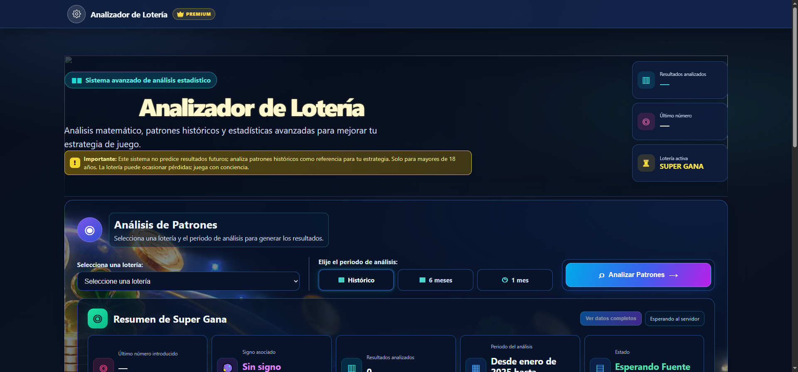

# Analizador de loterías · Demo de datos

**Diseño y desarrollo: Xioleni Salazar** · [Portafolio](https://xioleni.com/)

[Abrir el analizador](https://xioleni.com/proyectos/analizador-loterias/)

## Descripción del proyecto

Interfaz para procesar y explorar datos históricos de lotería mediante filtros, patrones y visualizaciones interactivas. El objetivo es presentar la información de forma visual para facilitar su lectura y comparación.

## Ficha del proyecto

- **Tipo:** herramienta de análisis y visualización.
- **Código:** HTML · CSS · JavaScript · Chart.js.
- **Dificultad:** Media–alta.
- **Enfoque:** exploración, filtros y lectura visual de patrones.

## Qué incluye

- Datos de ejemplo integrados en el repositorio y paneles de análisis.
- Filtros para explorar los resultados históricos disponibles.
- Gráficas y comparativas interactivas creadas con Chart.js.
- Estructura de interfaz preparada para evolucionar con un backend.

## Datos y alcance

Esta copia estática usa una muestra histórica de solo lectura en [`backup/loterias_backup.json`](backup/loterias_backup.json). No incluye sincronización en vivo ni acciones de administración; esas funciones pertenecen al backend del sitio alojado.

Las frecuencias y patrones describen resultados pasados: no predicen sorteos futuros ni aumentan la probabilidad de ganar.

## Ejecutar localmente

Sirve la carpeta con `py -m http.server 8000` y abre `http://localhost:8000` para que el navegador pueda cargar el archivo JSON.

## Créditos

Diseño e implementación de **Xioleni Salazar**.

## Presentaci&oacute;n r&aacute;pida

Interfaz de consulta y visualizaci&oacute;n de datos hist&oacute;ricos con filtros y gr&aacute;ficos.

**Demo:** consulta el enlace indicado arriba. **C&oacute;digo:** abre este repositorio. Las capturas muestran el proyecto local tal como est&aacute; en este c&oacute;digo.

## Decisiones y validaci&oacute;n manual

Prueba filtros y selecci&oacute;n de series; revisa que las gr&aacute;ficas correspondan al conjunto hist&oacute;rico seleccionado. El an&aacute;lisis no predice sorteos ni recomienda apuestas.

Este repositorio no incluye una suite de pruebas automatizadas. La lista anterior sirve como comprobaci&oacute;n manual de la demo; no se presenta como un resultado de pruebas autom&aacute;ticas.

## Aporte y alcance

Dise&ntilde;o e implementaci&oacute;n de portafolio por Xioleni Salazar. El proyecto demuestra decisiones de interfaz y comportamiento frontend en una demo; no representa una tienda en producci&oacute;n ni trabajo para un cliente.
